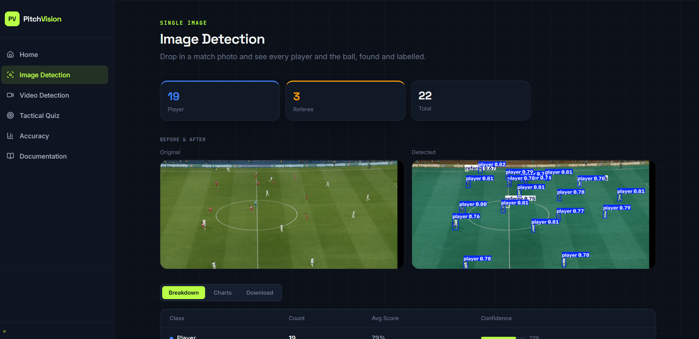
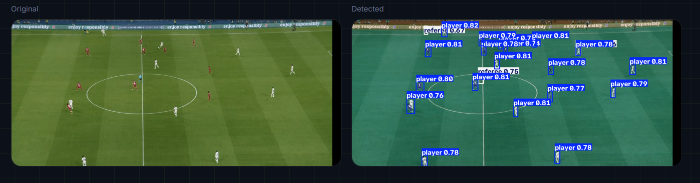
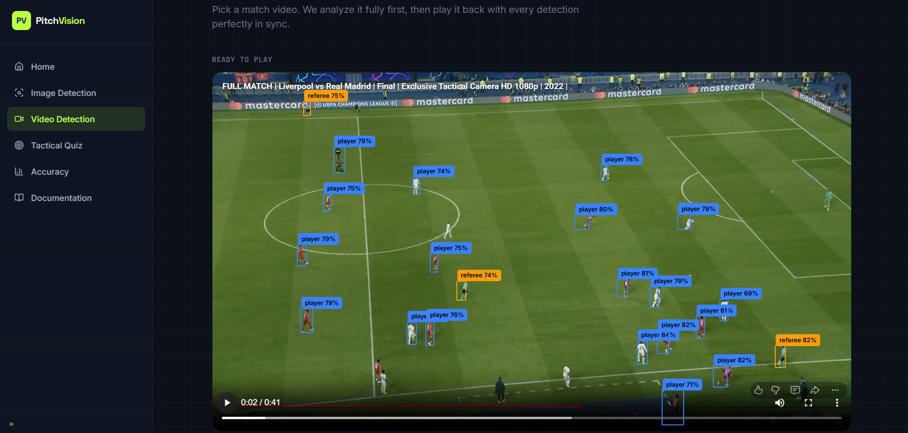

<div align="center">

# ⚽ PitchVision

**Football detection, player tracking and a tactics quiz, built from real match footage.**

[](https://python.org)
[](https://react.dev)
[](https://fastapi.tiangolo.com)
[](https://github.com/ultralytics/ultralytics)
[](#license)

Upload a match photo or clip and watch every player, goalkeeper, referee and the ball get found and labelled. Then turn that same clip into a tactics quiz, pause on a big moment and pick the pass yourself.

[Features](#features) · [Getting Started](#getting-started) · [The Story](#the-story) · [Project Structure](#project-structure)

</div>

---

## Demo

**Image Detection.** Drop in a match photo, get every player and referee boxed with confidence scores.



**Before and after.** Original frame next to the annotated detections.



**Video Detection.** A full clip analyzed and played back with every detection in sync.



> 📹 **Demo video coming soon**

---

## Features

| | Feature | Details |
|---|---|---|
| 🔍 | **Object Detection** | Players, goalkeepers, referees, ball, from a single photo |
| 🎥 | **Video Detection** | Full clip analyzed, then played back with synced overlays |
| 🎯 | **Tactical Quiz** | Tracked footage pauses on a decision, you pick the pass |
| 📊 | **Detection Breakdown** | Per class counts, confidence scores, charts |
| 📥 | **Export** | Annotated PNG, CSV spreadsheet, text report |
| 📈 | **Accuracy Dashboard** | Real training metrics, precision recall curves |

---

## Tech Stack

**Frontend**


**Backend**


**Model**


---

## Getting Started

### Prerequisites

- Python 3.10+
- Node.js 18+

### Installation

**1. Clone the repository**

```bash
git clone https://github.com/YOUR_USERNAME/pitchvision.git
cd pitchvision
```

**2. Set up the Python backend**

```bash
python -m venv .venv
# Windows
.venv\Scripts\activate
# macOS / Linux
source .venv/bin/activate

pip install -r requirements.txt
```

**3. Install frontend dependencies**

```bash
cd frontend
npm install
cd ..
```

### Running in Development

Open two terminals:

```bash
# Terminal 1, backend
python server.py
# API at http://localhost:8000
```

```bash
# Terminal 2, frontend
cd frontend
npm run dev
# UI at http://localhost:5173
```

### Running in Production (single server)

```bash
cd frontend && npm run build && cd ..
python server.py
# Full app at http://localhost:8000
```

---

## The Story

This started as a university project. Just a photo detector, nothing clever. I trained a YOLOv8n model on a small, messy dataset I pulled together on Roboflow, and it worked. Upload a photo, every player boxed in seconds.

But a photo only knows one frame. I wanted PitchVision to watch a whole match, not just a snapshot of one, so I went looking for something heavier.

SoccerNet Tracking is real broadcast football, tracked frame by frame by actual professionals. Getting it was its own small ordeal. A signed agreement, a password, downloads that stalled for no reason, a GPU quota that ran out mid training and sent me from Kaggle to Colab halfway through. I never trained from zero though. Both models started from a pretrained checkpoint and were fine tuned from there, which is the only reason any of this finished in days instead of weeks.

That dataset became YOLO26n, the model running now. Same four classes as before, but it finally understands motion, not just a single still.

Tracking brought its own fight. Players bunched together would bleed into each other's shirt colour and end up on the wrong team. I taught it to skip anyone too crowded to read cleanly. It still gets the odd one wrong, especially a goalkeeper in a strange kit, but it is close enough now to build a quiz on top of. Pause the right moment, and ask who this player should pass to.

---

## Project Structure

```
pitchvision/
├── server.py              # FastAPI backend: inference, tracking, quiz API
├── tactiq/                # Tracking, team classification, quiz session logic
├── requirements.txt       # Python dependencies
├── Notebooks/              # Training notebooks, Roboflow and SoccerNet
│
├── frontend/               # React application (Vite + Tailwind)
│   ├── src/
│   │   ├── pages/          # Home, Analyze, Live, Quiz, Accuracy, Docs
│   │   ├── components/     # Sidebar, shared UI primitives
│   │   └── App.jsx         # Router
│   ├── package.json
│   └── dist/                # Production build output (generated)
│
├── models/
│   └── football_best.pt    # Currently deployed weights
│
└── assets/
    ├── Screenshots/         # README images
    ├── results.csv          # Training log
    └── results.png          # Training plot
```

---

## License

Released for educational and research purposes.
Model weights are derived from [Ultralytics YOLO](https://github.com/ultralytics/ultralytics) under AGPL-3.0.
